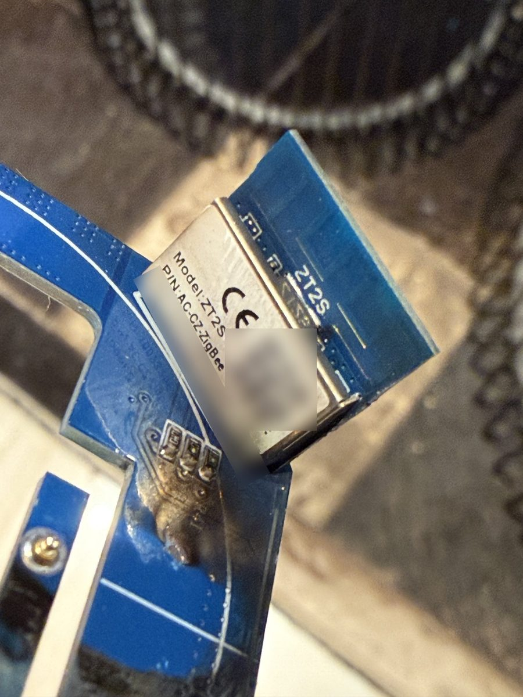
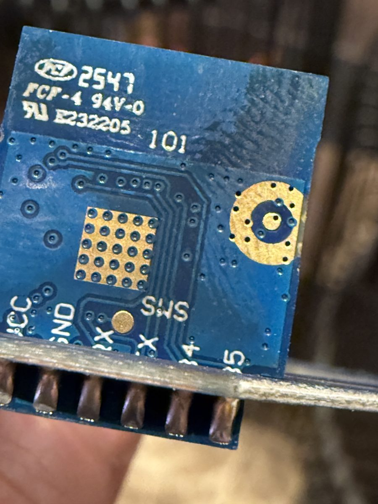
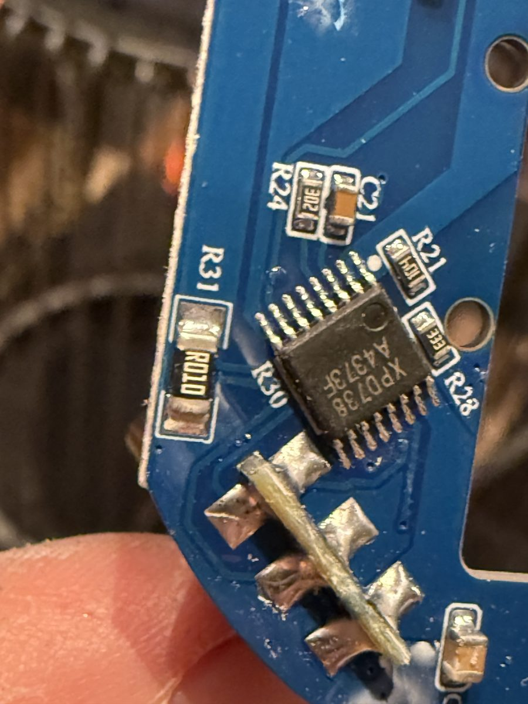
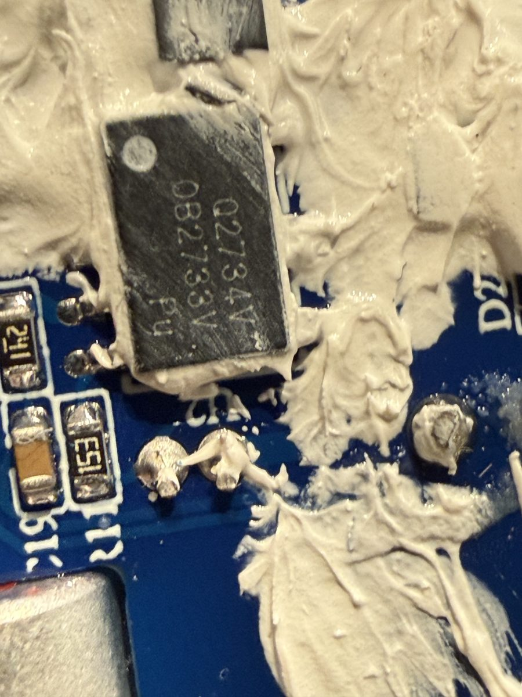
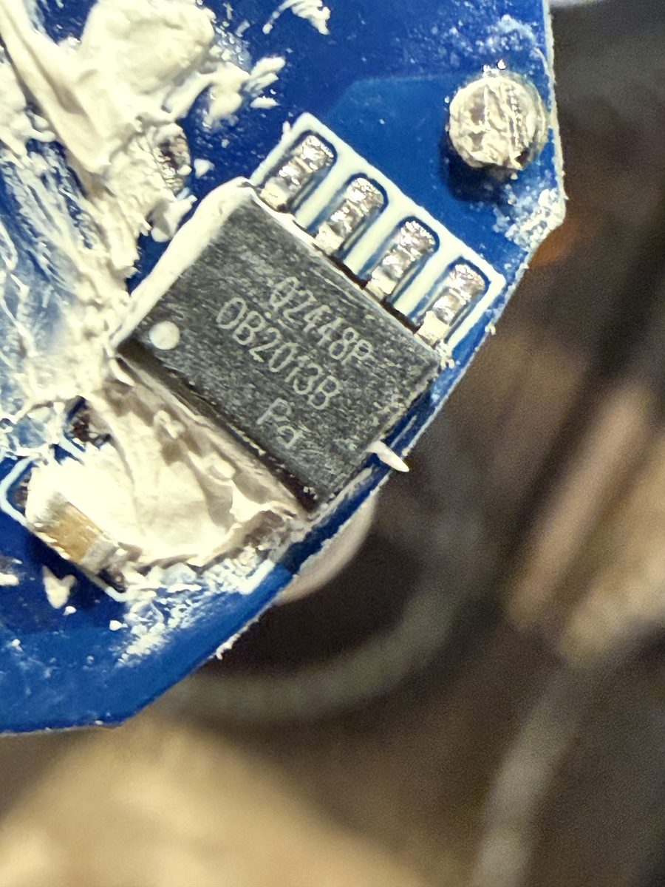
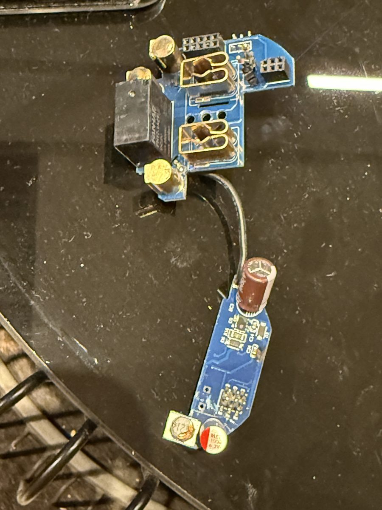
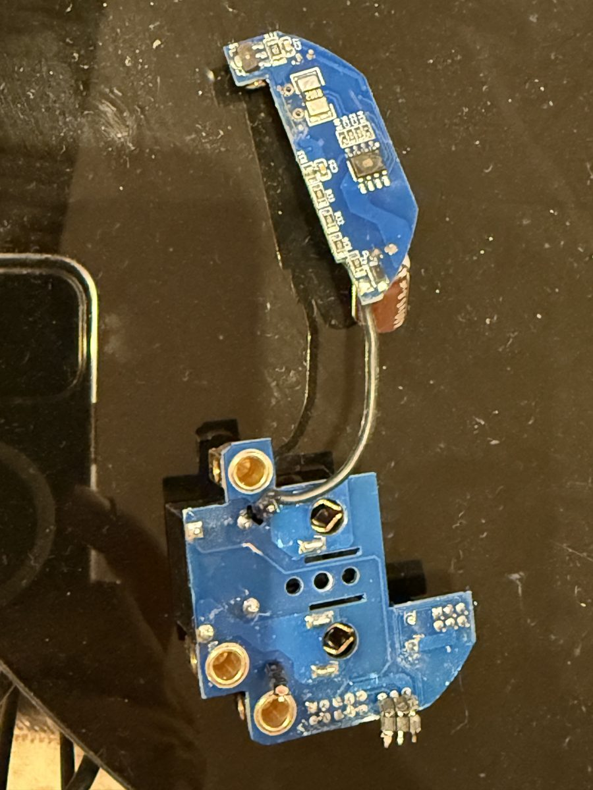
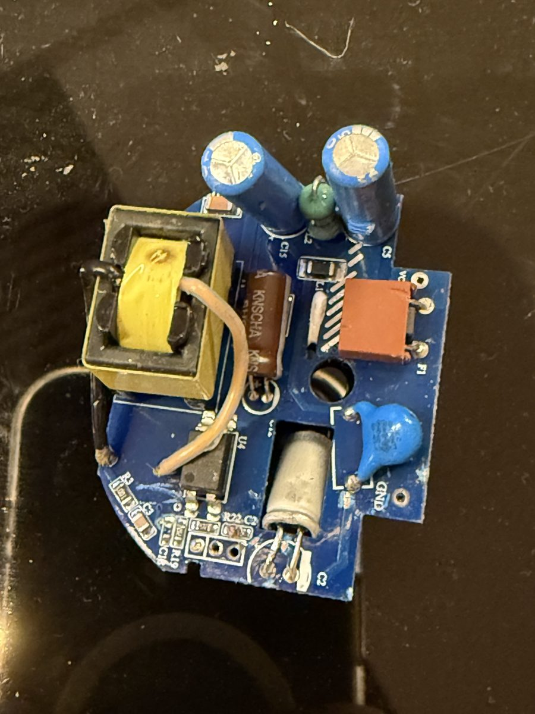

# BSEED wall socket with power monitoring and USB — `_TZ3210_5ct6e7ye`

Working notes for porting the custom firmware to this socket. Kept in the
`socket-discovery` branch of the teodtodo-ai fork. Facts are marked with their
source; anything not yet verified on hardware says so.

## Identification (read from the devices over Zigbee, 6 Nov 2026)

| Field | Value |
|---|---|
| Zigbee manufacturer | `_TZ3210_5ct6e7ye` |
| Zigbee model | `TS011F` |
| Z2M definition | BSEED "Wall-mounted electrical EU/FR/UK socket with power monitoring and USB" (whitelabel of `TS011F_plug_1`) |
| Stock OTA manufacturer code | 4417 (0x1141) |
| Stock OTA image type | 54179 (same as the other BSEED PM outlets in `device_db.yaml`) |
| Stock firmware versions seen | 83 and 86 (`appVersion`), hardware version 1 |
| Custom firmware image type | 47500 (chosen for this fork; unused in romasku and HobboRobin) |
| Custom manufacturer / model | `5ct6e7ye` / `TS011F-BS-PM-5` |

All eleven sockets in the installation are this variant; only the firmware
version differs (83 vs 86).

## Why custom firmware: stock firmware 83 report flood

Observed in the Zigbee2MQTT debug log on two units with stock firmware 83:

- The socket sends `attributeReport` for `haElectricalMeasurement`
  (`rmsVoltage`, `rmsCurrent`, `activePower`) several times per second with
  **unchanged values** (about 5 MQTT publishes per second per socket).
- The reporting configuration stored in the socket is sane (min 5 s,
  max 3600 s, reportable change 50 mA / 5 V / 10 W) — the firmware ignores it.
- A power cycle stops the flood temporarily; it comes back later. A third unit
  on version 83 was quiet at the time of the check, so the fault is
  intermittent. Units on version 86 were quiet.
- Z2M offers no OTA above 83 for the affected units.

Changing the reporting configuration does not help. Z2M `throttle` only hides
the flood from MQTT/HA (the radio traffic stays); `debounce` must not be used —
its timer restarts on every message, so under a continuous flood it never
publishes.

## Hardware (photos of one opened unit, 6 Nov 2026)

| Part | What it is | Source |
|---|---|---|
| Tuya **ZT2S** module (`P/N AC-CZ-ZigBee`) | Zigbee SoC, Telink family (internal pins named `TL_*`); 1 MB flash, 64 KB RAM | photo 1, [Tuya ZT2S datasheet (FCC)](https://fcc.report/FCC-ID/2ANDL-ZT2S/5498669.pdf) |
| XPD738BP (Shenzhen Fuman), TSSOP-16, next to shunt `R010` | USB-A/USB-C fast-charge controller; the 10 mΩ shunt measures **USB** current, not mains | photo 3 |
| On-Bright OB2733 / OB2013B | power-supply controllers | photos 4, 5 |
| Energy-metering chip | **not identified yet** (not readable on the photos) | — |

The MCU is assumed to be TLSR8258 (the `TL_*` pin names match; the datasheet
does not name the chip).

### ZT2S pins (from the datasheet)

| Module pin | Name | TLSR825x pin | Notes |
|---:|---|---|---|
| 1 | VCC | — | 3.3 V |
| 2 | C2 | PC2 | GPIO, PWM |
| 3 | GND | — | |
| 4 | C3 | PC3 | GPIO, PWM |
| 5 | RX | PB7 | UART RX |
| 6 | D2 | PD2 | GPIO, PWM |
| 7 | TX | PB1 | UART TX |
| 8 | C4 | PC4 | GPIO, ADC |
| 9 | B4 | PB4 | GPIO, PWM |
| 10 | RST | — | reset, active low |
| 11 | B5 | PB5 | GPIO, PWM |
| 12 | SWS | — | programming pin — **wired recovery is possible** |

The SWS pad is reachable on the back of the module (photo 2), so a unit can be
reflashed over a wire if an OTA ever leaves it unusable.

## Pinout discovery

Pins are set by the `config_str` and can be changed at runtime from Z2M
(*Device config*), without reflashing. After a change that adds or removes a
cluster, run **Re-interview** in Z2M.

First guess (compiled-in default of the discovery build):

```
5ct6e7ye;TS011F-BS-PM-5;LC3p;RD2;IB4p;EPC4C2B1;
```

- `LC3p` network LED, `RD2` relay, `IB4p` relay indicator — the same pins as
  the two hardware-verified BSEED revisions (`_TZ3000_b28wrpvx`,
  `_TZ3000_4ux0ondb`), all of which exist on the ZT2S.
- `EPC4C2B1` — HLW8012/BL0937 guess: CF=C4, CF1=C2, SEL=B1 (C2/B1 as on
  `_TZ3000_b28wrpvx`; its CF pin A1 does not exist on the ZT2S).
- **No switch (`S`) on purpose.** Without a button there is no multi-press
  factory reset, so a wrong input pin cannot make the socket leave the network.
  Before adding the button (`SB5u`), set `multi_press_reset_count` to 0.
- If the metering chip is a UART type, the natural candidate is
  `EBB1B7` (TX=B1, RX=B7).
- **Overload protection stays at its defaults** (10 A for 30 s / 16 A peak;
  it cannot be switched off, only raised with an `OL` token). With wrong
  metering pins the readings are meaningless and can trip it — e.g. CF1 right
  but SEL wrong turns ~224 V of voltage pulses into ~17 A of "current" and the
  relay switches off on its own (reconnect after 60 s, lock-out after 5 trips).
  **On every test, check `overload_alarm` in Z2M** before concluding that the
  relay pin is wrong. If it gets in the way, append `OLC65000P65000`
  (caps above anything the code can compute: 54 A / 6380 W) — discovery only.
- Test with nothing plugged in: SEL toggles B1 every ~25 s, and on another
  ZT2S device (Girier) B1 is a button input.

Test log (fill in on every test):

| Date | config_str / change | Result |
|---|---|---|
| | | |

## Calibration

Not done yet. Method: steady resistive load (kettle or heater) and a reference
meter; `new_multiplier = old_multiplier * measured / reported`.

| Date | Load | Reference V / A / W | Multipliers V / A / W |
|---|---|---|---|
| | | | |

## Building and flashing

- Workflow `.github/workflows/build-socket.yml` builds only this board on
  every push to `socket-discovery` and publishes to the `smart-dimming-ota`
  branch, folder `<commit>/socket_test/`, with a ready Z2M index
  `index_socket_test.json` (stock→custom file and the normal file).
- **Version counter:** `board.mk` derives the last byte of the OTA version from
  the commit count ahead of `origin/main`. On this branch that count is >255 and
  overflows (`0x130030138`); the workflow passes `STACK_BUILD` counted from the
  branch base `235e2927a` instead (first build: `0x13003001`).
- Z2M converter for the custom model: `zigbee2mqtt/converters/socket_5ct6e7ye.js`
  (only this model, so it can sit next to the switch converter
  `switch_custom.js` from the `smart-dimming` branch). Regenerate with
  `helper_scripts/make_z2m_custom_converters.py` from a database that contains
  only this entry with `build: yes`.
- Test unit: **socket BSEED test** (`0xa4c13803ca0e9d0a`, stock version 86).
  All socket tests run on this unit only.
- Back to stock: not available as an OTA file; wired flashing of a stock dump
  would be needed.

## Photos

Serial number and QR code on the module label are blurred; metadata stripped.

| | |
|---|---|
|  |  |
|  |  |
|  |  |
|  |  |
